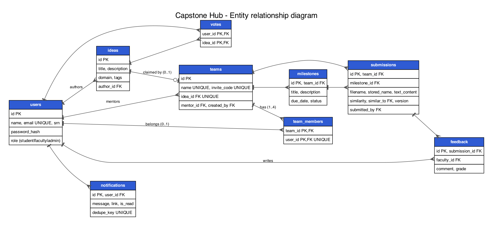
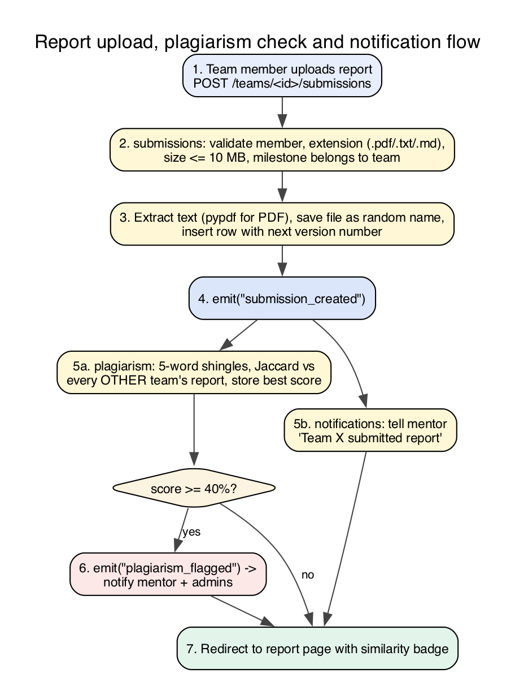

# Software Design Document
## Capstone Hub

| | |
|---|---|
| Version | 1.0 |
| Related | [SRS](SRS.md), [Architecture](Software_Architecture_Document.md), [Test Plan](Test_Plan.md) |

## 1. Overview
Capstone Hub is a Flask 3 application in the `capstone/` package. `create_app()` builds the app, initialises the database and security hooks, then loads each feature module listed in `MODULES`.

## 2. Module design

| Module | Responsibility | Requirements | Owner |
|---|---|---|---|
| `__init__.py` | App factory, configuration, module loading | NFR-05 | Praneel |
| `db.py`, `schema.sql` | Connection per request, schema, `init-db`, `today()` (overridable for tests) | NFR-04 | Praneel |
| `security.py` | Session user, CSRF tokens, `login_required`, `role_required`, `safe_next` | NFR-01 | Praneel |
| `events.py` | `subscribe(app, event, handler)` / `emit(event, **data)` | - | Praneel |
| `core.py` | Home page, `/health` | - | Praneel |
| `auth.py` | Register, log in, log out | FR-01 | Praneel |
| `dashboard.py` | Dashboard assembled from module widgets | FR-08 | Praneel |
| `ideas.py` | Idea CRUD, search, filter, sort | FR-02, FR-03 | Dhruv |
| `votes.py` | Vote toggle | FR-04 | Meghana |
| `teams.py` | Create, join, leave, team page | FR-05 | Dhriti |
| `allocation.py` | Claim/release idea, mentor assignment | FR-06 | Dhriti |
| `milestones.py` | Milestone CRUD, status, progress, overdue | FR-07, FR-08 | Dhriti |
| `submissions.py` | Upload, text extraction, versioning, download | FR-09 | Meghana |
| `plagiarism.py` | Shingling, Jaccard similarity, flagging | FR-10 | Praneel |
| `feedback.py` | Faculty comments and grades | FR-11 | Meghana |
| `notifications.py` | Inbox, reminders, event subscribers, `send-reminders` | FR-12, FR-13 | Dhruv |
| `reports.py` | Progress report and CSV export | FR-14 | Meghana |
| `errors.py`, `seed.py` | Error pages, demo data | NFR-03 | Praneel |

## 3. Routes

| Method | Path | Who | Purpose |
|---|---|---|---|
| GET | `/` | all | Home (redirects to dashboard when logged in) |
| GET/POST | `/auth/register`, `/auth/login` | guests | Register, log in |
| POST | `/auth/logout` | users | Log out |
| GET | `/dashboard` | users | Role-specific widgets |
| GET | `/ideas/` | users | List, `?q=&domain=&sort=votes` |
| GET/POST | `/ideas/new`, `/ideas/<id>/edit` | users / author, admin | Create, edit |
| GET | `/ideas/<id>` | users | Idea detail |
| POST | `/ideas/<id>/delete` | author, admin | Delete unclaimed idea |
| POST | `/ideas/<id>/vote` | users except author | Toggle vote |
| POST | `/ideas/<id>/claim` | student in team | Claim idea |
| GET | `/teams/` | users | Student: own team or join page; staff: all teams |
| POST | `/teams/create`, `/teams/join` | students | Create, join with code |
| GET | `/teams/<id>` | members, faculty, admin | Team page |
| POST | `/teams/<id>/leave` | members | Leave |
| POST | `/teams/<id>/release` | members, mentor, admin | Release idea |
| POST | `/teams/<id>/mentor`, `/teams/<id>/unmentor` | faculty, admin | Mentor assignment |
| POST | `/teams/<id>/milestones` | mentor, admin | Add milestone |
| POST | `/milestones/<id>/status`, `/milestones/<id>/delete` | members+mentor / mentor | Update, delete |
| POST | `/teams/<id>/submissions` | members | Upload report |
| GET | `/submissions/<id>`, `/submissions/<id>/download` | members, faculty, admin | View, download |
| POST | `/submissions/<id>/feedback` | faculty, admin | Add feedback |
| GET | `/plagiarism/` | faculty, admin | Flagged reports |
| GET | `/notifications/` ; POST `/notifications/<id>/open`, `/notifications/read-all` | users | Inbox |
| GET | `/reports/`, `/reports/export.csv` | faculty, admin | Progress report |

## 4. Data design

Key constraints:
- `team_members.user_id` is UNIQUE (one team per student).
- `teams.idea_id` is UNIQUE (one team per idea).
- `votes` has primary key (user_id, idea_id) (one vote per user per idea).
- `notifications.dedupe_key` is UNIQUE (no duplicate reminders).
- Cascades: deleting a team removes its members, milestones and submissions; deleting an idea removes its votes.

## 5. Key algorithms

### 5.1 Plagiarism check (FR-10)
1. Lower-case the report text and split it into alphanumeric words.
2. Build the set of 5-word shingles (overlapping word windows).
3. For every report belonging to a **different** team, compute Jaccard similarity |A ∩ B| / |A ∪ B|.
4. Store the highest score and the matching report id; if score ≥ 0.40, emit `plagiarism_flagged`.

Shingles make the check robust to small edits, while different reports on the same topic rarely share long word sequences.

### 5.2 Reminders (FR-12)
For every milestone not marked done with `due_date ≤ today + 3 days`:
- if `due_date < today`: an "Overdue" notification goes to each member and the mentor;
- otherwise: a "Reminder" notification goes to each member.

Each notification has `dedupe_key = kind:milestone:due_date:user`, inserted with `INSERT OR IGNORE`, so running the job many times never duplicates reminders. The job runs on the first request of each day and through the `send-reminders` command.

### 5.3 Upload flow (FR-09 → FR-10 → FR-13)

## 6. User interface
Server-rendered pages share `base.html` (top navigation filtered by role, flash messages, unread badge). Pages use a responsive CSS grid that collapses to one column below 600 px. Optional panels (milestones, reports, feedback, plagiarism badge) are included only when their module is installed.

## 7. Security design
- Passwords: `werkzeug.security.generate_password_hash` (scrypt, salted).
- CSRF: per-session random token, checked in `before_request` for every POST with `secrets.compare_digest`.
- Authorisation: decorators plus per-object checks (`is_member`, `is_staff_for`, `can_view`).
- Uploads: extension allow-list, 10 MB limit, stored as `uuid4().hex + ext`, downloaded only through an access-checked route.
- Redirects: `safe_next` only allows same-site relative paths.
