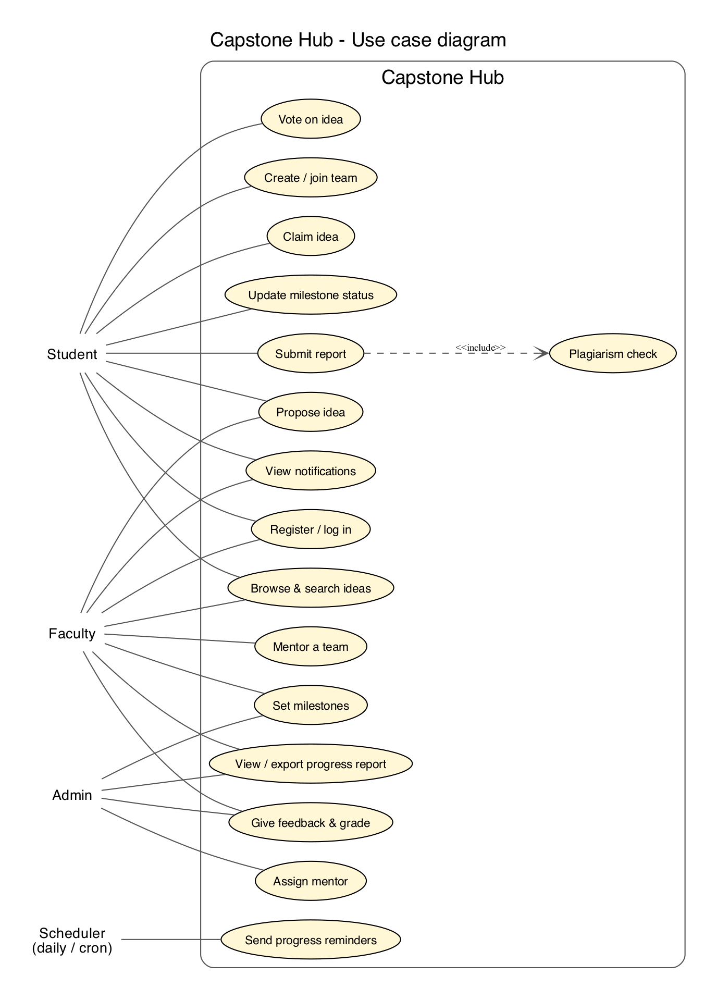

# Software Requirements Specification
## Capstone Hub: Integrated Capstone Idea Bank, Project Management, Tracking and Reporting Platform

| | |
|---|---|
| Project | SE Mini Project, Topic #21 |
| Team | Chirra Yuktha Praneel (PES2UG24AM049), Dhruv Uppalapati (PES2UG24AM054), Dhriti L Krishna (PES2UG24AM052), Meghana (PES2UG24AM075) |
| Version | 1.0 |
| Course | Software Engineering, PES University |

## 1. Introduction

### 1.1 Purpose
This document specifies the functional and non-functional requirements of Capstone Hub, a web portal where students browse capstone ideas, form teams, track milestones, submit reports and receive faculty feedback. It is the reference for design, implementation, the product backlog and testing.

### 1.2 Scope
Capstone Hub replaces the spreadsheets, e-mail threads and shared drives that capstone projects are usually run on. It covers the full lifecycle of a capstone project inside one department:

1. **Idea bank:** faculty and students propose ideas; everyone can search, filter and vote.
2. **Team formation:** students form teams of up to four with an invite code; a team claims one idea; a faculty member mentors it.
3. **Tracking:** mentors set dated milestones; teams update status; progress and overdue work are visible on dashboards.
4. **Reporting:** teams upload versioned reports; every report is plagiarism-checked against other teams; faculty give comments and grades; staff export a progress report.
5. **Reminders:** the system automatically reminds teams of due and overdue milestones.

Out of scope: institution-wide single sign-on, e-mail/SMS delivery, and comparison against internet sources for plagiarism (see section 6).

### 1.3 Definitions
| Term | Meaning |
|---|---|
| Idea | A proposed capstone project (title, description, domain, tags) |
| Team | 1-4 students working on one claimed idea |
| Mentor | The faculty member responsible for a team |
| Milestone | A dated deliverable set by the mentor (for example "SRS review") |
| Submission / report | A file uploaded by a team, optionally against a milestone |
| Similarity | Jaccard similarity of 5-word shingles between two reports, 0-100% |

### 1.4 References
SE Mini Project Deliverables Part-2 (PES University); IEEE 830-1998 Recommended Practice for SRS.

## 2. Overall description

### 2.1 Product perspective
A new, self-contained web application. It is used in a browser and needs no client installation. It runs on a single server with an embedded SQLite database.

### 2.2 User classes
| User | Description | Main tasks |
|---|---|---|
| Student | Undergraduate doing a capstone | Propose/vote on ideas, form a team, claim an idea, update milestones, upload reports, read feedback |
| Faculty | Teaching staff; registers with a faculty sign-up code | Propose ideas, mentor teams, set milestones, review reports and plagiarism flags, give feedback, view reports |
| Admin | Capstone coordinator | Everything faculty can do, plus assigning mentors to any team and editing any idea |
| Scheduler | Daily job (automatic, or cron) | Generates due-soon and overdue reminders |

### 2.3 Operating environment
Server: Python 3.10+ with Flask 3 and SQLite (Windows, macOS or Linux). Client: any current desktop or mobile browser.

### 2.4 Constraints
- Must be built and demonstrated within two one-week sprints.
- Free and open-source stack only; no paid services.
- Uploaded reports are limited to PDF, TXT and Markdown, at most 10 MB.

### 2.5 Assumptions and dependencies
- Each student belongs to at most one team at a time.
- The faculty sign-up code is shared with faculty out of band.
- Report text can be extracted (scanned image-only PDFs give an empty text and therefore 0% similarity).

## 3. Functional requirements

Priority: **M** = must, **S** = should.

| ID | Requirement | Priority | Acceptance criteria |
|---|---|---|---|
| FR-01 | Users register with name, e-mail, SRN, password and role, and log in/out. | M | E-mail unique; password at least 8 chars; faculty need the sign-up code; admin cannot self-register; wrong credentials rejected. |
| FR-02 | Any logged-in user can propose an idea with title, description, domain and tags; authors (or admin) can edit/delete it. | M | Title 5-120 chars, description at least 20 chars, domain from a fixed list; claimed ideas cannot be deleted. |
| FR-03 | Users browse the idea bank and search by keyword, filter by domain and sort by newest or most votes. | M | Search matches title, description and tags; results show votes and claim status. |
| FR-04 | Users vote for ideas: one vote per user per idea, toggleable; authors cannot vote for their own idea. | S | Vote count updates; second click removes the vote; sorting by votes reflects counts. |
| FR-05 | Students create a team (gets an 8-character invite code), join with a code, and leave. | M | Max 4 members; one team per student; unique team name; last member leaving deletes the team unless it has submissions. |
| FR-06 | A team claims one open idea; a faculty member takes a team as mentor; admin can assign any faculty member. | M | One idea per team and one team per idea (enforced even under concurrent claims); a team can release its idea. |
| FR-07 | The mentor (or admin) creates milestones with title, due date and description; team members and mentor update status (pending, in progress, done). | M | Invalid dates rejected; only members/mentor/admin can change status; only mentor/admin create or delete. |
| FR-08 | The system shows progress (% of milestones done) and overdue milestones on the team page and dashboards. | M | Overdue = not done and due date before today. |
| FR-09 | Team members upload reports (.pdf, .txt, .md, up to 10 MB), optionally linked to a milestone; each upload gets the next version number. | M | Other file types, empty files and unreadable PDFs rejected; only members, faculty and admin can view or download. |
| FR-10 | Every uploaded report is automatically compared with all other teams' reports; the highest similarity and closest match are stored and reports at or above 40% are flagged. | M | Same-team versions are not compared; flagged list visible to faculty/admin only. |
| FR-11 | Faculty/admin add written feedback and an optional grade (A-F) to a report; the team sees it. | M | Comment 1-2000 chars; invalid grade rejected. |
| FR-12 | The system automatically creates reminders for milestones due within 3 days and overdue milestones, once per day, and via a CLI command for cron. | M | No duplicate reminder for the same milestone, date and user; overdue reminders also go to the mentor. |
| FR-13 | Users have a notification inbox (unread badge, open, mark all read) and receive notifications for new submissions (mentor), new feedback (team) and plagiarism flags (mentor and admins). | S | Users only see their own notifications; links only go to pages on this site. |
| FR-14 | Faculty/admin view a progress report of all teams (or only their mentored teams) and export it as CSV. | S | Columns: team, members, idea, mentor, milestones done/total, %, overdue, reports, max similarity, last submission. |

## 4. Non-functional requirements

| ID | Category | Requirement | How it is verified |
|---|---|---|---|
| NFR-01 | Security | Passwords stored as salted hashes; all state-changing requests protected by CSRF tokens; role-based access on every route; no open redirects; uploads stored under random names. | Unit tests for hashing, CSRF rejection, 403s and redirect checks. |
| NFR-02 | Performance | The idea bank lists 500 ideas with vote counts in under 1 second on a laptop. | Automated timing test with 500 ideas. |
| NFR-03 | Usability | Responsive layout usable on a 360 px phone; clear error pages for 400/403/404/413; every form field labelled. | Viewport test, manual check on mobile width, error-page tests. |
| NFR-04 | Reliability | Uploads limited to 10 MB; a team with submissions cannot be accidentally deleted; database constraints enforce one team per student and one team per idea. | Tests for 413, leave-team rule and claim conflicts. |
| NFR-05 | Maintainability | Modular blueprints; flake8-clean; automated tests with at least 80% coverage, run by CI on every push and pull request. | GitHub Actions CI with coverage gate. |
| NFR-06 | Portability | Runs with `pip install -r requirements.txt` on Python 3.10-3.12 on Windows, macOS and Linux. | CI matrix on Python 3.10, 3.11 and 3.12. |

## 5. External interfaces
- **User interface:** server-rendered HTML pages: Home, Register, Log in, Dashboard, Idea Bank, Idea, Team, Report, Notifications, Plagiarism, Reports.
- **Software interfaces:** SQLite 3 database; pypdf for PDF text extraction.
- **Command-line interface:** `flask --app capstone init-db | seed-demo | send-reminders`.

## 6. Future scope
E-mail delivery of reminders, institutional SSO, comparison against previous years' archives and web sources (MinHash/LSH for scale), and file preview in the browser.

## 7. Traceability to backlog
| Requirement | Backlog item |
|---|---|
| FR-01, NFR-01 | US-02 |
| FR-02, FR-03 | US-03 |
| FR-04 | US-04 |
| FR-05 | US-05 |
| FR-06 | US-06 |
| FR-07, FR-08 | US-07 |
| FR-09 | US-08 |
| FR-10 | US-09 |
| FR-11 | US-10 |
| FR-12, FR-13 | US-11 |
| FR-14 | US-12 |
| NFR-02, NFR-03, NFR-04 | US-13 |
| NFR-05, NFR-06 | US-01 |
