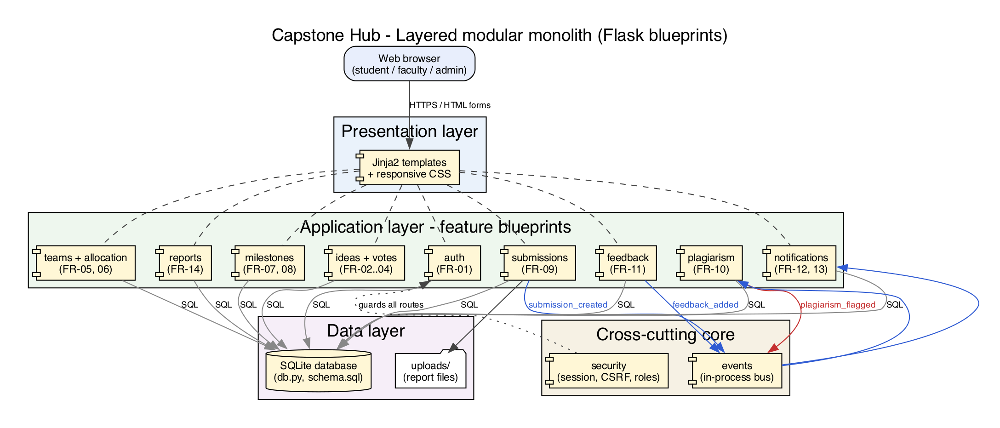

# Software Architecture Document
## Capstone Hub

| | |
|---|---|
| Version | 1.0 |
| Related | [SRS](SRS.md), [Design Document](Design_Document.md) |

## 1. Architectural goals and constraints
- Deliver all 14 functional requirements in two one-week sprints with a four-person team, so the architecture must let members work on features in parallel without stepping on each other.
- Run on a single small server or a student laptop for demos (SRS 2.3, NFR-06).
- Keep sensitive data (passwords, reports) protected and access role-based (NFR-01).
- Be testable automatically in CI (NFR-05).

## 2. Architectural style: layered modular monolith

We chose a **layered architecture** delivered as a **modular monolith**: one Flask application split into feature modules (Flask blueprints), with three layers.

| Layer | Contents |
|---|---|
| Presentation | Jinja2 templates and CSS, rendered on the server |
| Application | One blueprint per feature: `auth`, `ideas`, `votes`, `teams`, `allocation`, `milestones`, `submissions`, `plagiarism`, `feedback`, `notifications`, `reports`, plus `core`, `dashboard`, `errors` |
| Data | `db.py` (connection per request) and `schema.sql` on SQLite; uploaded files in the instance `uploads/` folder |

Two cross-cutting modules sit beside the layers: `security` (session user, CSRF, role decorators) and `events` (an in-process publish/subscribe bus).



### 2.1 Alternatives considered
| Style | Verdict | Reason |
|---|---|---|
| Microservices | Rejected | Independent scaling is not needed for one department (hundreds of users). Network calls, service discovery and distributed data would cost more than the two sprints allow. |
| Client-server SPA (React + REST API) | Rejected | Two code bases and an API contract to maintain; server-rendered pages meet the usability requirement with less work. |
| **Layered modular monolith** | **Chosen** | Simple to deploy (one process), easy to test with Flask's test client, and blueprints give each team member an isolated module. |

### 2.2 Key decisions
1. **Feature modules are registered from one list** (`capstone/__init__.py: MODULES`). Each sprint story adds its module name to that list. A module may expose `bp` (routes), `NAV` (menu entries), `init_module(app)` (hooks) and `dashboard_widget(user)`. This keeps merge conflicts between parallel stories to one line.
2. **Event bus instead of direct calls.** `submissions` emits `submission_created`; `plagiarism` and `notifications` subscribe. `feedback` emits `feedback_added`. `plagiarism` emits `plagiarism_flagged`. Features can be added or removed without editing the emitter.
3. **Templates check for optional features** with `has('module')`, so a page renders correctly whether or not a later module is installed. This allowed Sprint 1 to ship a working product before Sprint 2 modules existed.
4. **Database constraints back up business rules**: `UNIQUE(team_members.user_id)` gives one team per student, and `UNIQUE(teams.idea_id)` gives one team per idea even under concurrent requests.

## 3. Views

### 3.1 Logical view
See the architecture diagram above, and the module responsibilities in the [Design Document](Design_Document.md#2-module-design).

### 3.2 Process view
A single WSGI process handles requests synchronously. Plagiarism checking runs inline after an upload (an O(n) comparison, well under a second for a cohort). Reminders run in the first request of each day (`before_request` hook guarded by a `meta.reminders_last_run` stamp), and can also be run by cron with `flask --app capstone send-reminders`.

### 3.3 Deployment view
```
[Browser] --HTTPS--> [Reverse proxy (optional)] --> [Flask app (gunicorn/waitress)] --> [SQLite file + uploads/ folder]
```
For the course demo the built-in development server is used (`flask --app capstone run`).

### 3.4 Data view
Nine tables: users, ideas, votes, teams, team_members, milestones, submissions, feedback, notifications (plus `meta`). See the ER diagram in the Design Document.

## 4. Quality attributes
| Attribute | How the architecture supports it |
|---|---|
| Security (NFR-01) | Central `before_request` CSRF check and user loading; `login_required` / `role_required` decorators on every route; werkzeug password hashing; uploads saved under random UUID names and served only through an access-checked route. |
| Performance (NFR-02) | In-process calls (no network hops); indexes on hot columns; aggregate queries compute vote counts in one query. |
| Maintainability (NFR-05) | One module per feature, event bus for cross-feature reactions, 99% test coverage, flake8 in CI. |
| Portability (NFR-06) | Pure Python plus SQLite; CI matrix on 3.10-3.12. |
| Reliability (NFR-04) | Foreign keys with cascading deletes, unique constraints, upload size limit, guarded team deletion. |

## 5. Risks
| Risk | Mitigation |
|---|---|
| SQLite write locking under heavy concurrent use | Acceptable for one department; the data layer is isolated in `db.py` so it can move to PostgreSQL. |
| Plagiarism check is O(n) per upload | Fine for one cohort; documented upgrade path to MinHash/LSH. |
| Reminders depend on site traffic | Cron command `send-reminders` provided as a guaranteed trigger. |
